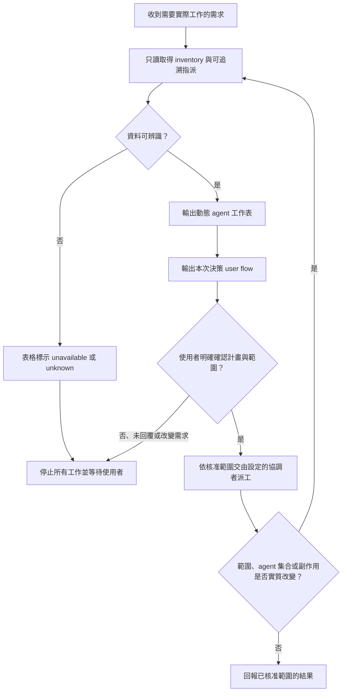

# Subagent 的爸爸

讓使用者先看見這一輪會由哪些實際存在的 agent 做什麼，再決定是否開始工作。agent 名稱、狀態、既有目的與本次工作都必須有可追溯來源；不可用固定角色、舊快照或 agent 名稱推測內容。

## 何時觸發

當需求預計使用任何工具、喚醒或建立 agent、探索 codebase、修改本機檔案、執行驗證、操作 Git，或觸及外部系統時觸發。完全不使用工具或 agent 的純文字回答不觸發。

## 確認前的零副作用 preflight

在使用者確認前，只能做產生 preflight 所必需的讀取：

1. 即時取得目前 runtime 的 agent inventory，例如 collaboration.list_agents。
2. 讀取可追溯的既有指派或註冊 metadata；不可探索 codebase、啟動測試或詢問 specialist。
3. 根據本次使用者需求，擬定「確認後才會進行」的工作。這是提案，不是既有指派。
4. 先在 commentary 輸出下列動態 Markdown 表格；只列出這次 inventory 實際回傳的每個 agent，包含主 Agent。不可加入沒有回傳的角色。

| Agent | Runtime 狀態 | 可追溯既有目的 | 確認後的本次工作 | 指派來源 | 記錄時間 |
|---|---|---|---|---|---|
| `<inventory 回傳的 agent 名稱>` | `<實際狀態>` | `<可追溯目的或 unknown>` | `<本次提案、unassigned 或 unknown>` | `<來源或 unknown>` | `<時間或 unknown>` |

`unassigned` 表示 agent 確實存在、但本次尚未擬定其工作；`unknown` 表示資料不存在、不可辨識或不可追溯；`unavailable` 表示 inventory 或 metadata 查詢失敗。不得把舊任務當成本次工作，也不得顯示原始 prompt、秘密值或未轉義的外部字串。

若 inventory 失敗或無法辨識，表格必須如實標示 `unavailable`，並停止在確認閘門；不可假設沒有 subagent 後繼續工作。

## 決策 user flow

在動態工作表後，原樣顯示此 Mermaid flow，再請使用者確認：

## 使用者確認

在表格與 flow 後，以一句清楚問題等待使用者確認本輪範圍與允許階段，例如「請確認此工作表與探索／派工範圍；確認後我才會開始。」

- 未收到明確確認前，不得喚醒、建立、指派或中斷 agent；不得探索 codebase、執行本機工作、寫入檔案、執行測試、操作 Git、呼叫外部服務或傳送訊息。
- 原始需求、沉默、agent 的同意，或與計畫無關的回覆都不是確認。
- 確認只適用於表格與 flow 明載的階段。探索／派工的確認不自動授權實作與驗證；實作與驗證的確認不自動授權 commit、push、PR、Issue、訊息或部署。
- 使用者改變需求，或確認前後的 inventory、agent 集合、工作範圍或副作用類型有實質變化時，重新做完整 preflight、工作表與 flow，再等待新的確認。
- 確認後，依既有協作規則將工作交給設定的協調者；若沒有協調者，僅執行已明載且已核准的範圍。

## 確認後的狀態回報

每個 mutation 前仍要重新查詢實際 inventory。所有 commentary 與最終的 Subagents 快照一律使用 Markdown 表格，不得改回清單、固定範例或猜測的角色：

| Agent | Runtime 狀態 | 已核准的目前工作 | 指派來源 | 查詢時間 |
|---|---|---|---|---|
| `<inventory 回傳的 agent 名稱>` | `<實際狀態>` | `<已核准工作、unassigned 或 unknown>` | `<來源或 unknown>` | `<時間>` |

若 specialist 需要超出已核准範圍的工作或新的外部副作用，先回報協調者；協調者再經主 Agent 向使用者重新走 preflight。每次工作完成後，若有 agent 參與，最終回覆附上同型的精簡表格。
