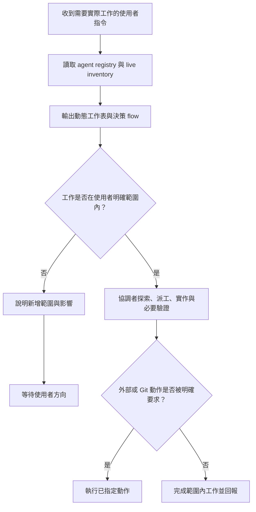

# Subagent 的爸爸

讓使用者看見這一輪實際可用的 agent、分工與決策路徑，同時保留直接下達指令後立即完成範圍內工作的能力。工作表與 Mermaid 是可見性工具，不是對同一件事重複索取確認的閘門。

## 何時觸發

當需求會使用工具、agent、codebase 探索、檔案變更、驗證、Git 或外部系統時觸發。完全不使用工具或 agent 的純文字回答不觸發。

## 建立動態 agent 視圖

在開始實際工作時：

1. 讀取可用的 agent registry（通常是 `$CODEX_HOME/agents/*.toml`），只採用可追溯的 `description` 或 metadata 作為既有目的。
2. 即時取得 runtime agent inventory。
3. 合併兩個來源，並在 commentary 顯示下表及本次 Mermaid decision flow。

| Agent | Registry | Runtime 狀態 | 可追溯既有目的 | 本次工作 | 資料來源 | 記錄時間 |
|---|---|---|---|---|---|---|
| `<agent 名稱>` | `configured / 未註冊` | `實際狀態 / unknown / unavailable` | `description、metadata 或 unknown` | `本次明確工作或 unassigned` | `registry、live inventory、PM 工作票` | `時間` |

- registry 有、但 runtime inventory 沒有的 agent，狀態一律寫 `unknown（未列入 live inventory）`，不可猜成 `idle`。
- inventory 有、但 registry 沒有的 agent，Registry 欄寫 `未註冊`。
- 本次工作只能取自目前使用者需求或目前 PM 工作票；不可沿用舊任務。尚未派工時寫 `unassigned`。
- inventory 或 registry 無法讀取時如實標為 `unavailable`，不可虛構 agent、狀態或職責。

## 決策 user flow

在動態工作表後顯示符合本次工作的 flow；至少要清楚呈現直接指令、範圍判斷、派工與外部動作授權。例如：

## 授權範圍

使用者明確的直接指令（例如「幫我做 X」）即授權完成 X 所需的唯讀探索、協調者派工、範圍內實作、格式化與必要驗證；不要再為同一範圍要求一次確認。

僅在下列情況暫停並向使用者說明需要的新增決定：

- 工作會實質擴大功能或 repository 範圍。
- 需要新增 dependency、migration、破壞性變更，或使用者沒有要求的跨系統修改。
- 要 commit、push、建立 PR／Issue、傳送訊息、部署或其他外部寫入，而使用者沒有明確要求該動作。
- inventory 不可用且工作依賴無法安全替代的 agent。

使用者在同一指令中明確列出的 commit、push、重新安裝或其他外部動作，視為該些動作的授權；不可延伸成未列出的 PR、Issue、部署或訊息。

## 協作與回報

- 依既有協作規則，主 Agent 將技術探索、工作拆分、專家派工與整合決策交給設定的協調者。
- specialist 只接受協調者的工作票，並把證據、驗證、契約假設、blocker 與待決事項回報給協調者。
- 每次開始、每個重大狀態改變、成組 mutation 前，以及有 agent 參與的最終回覆，都重新查詢 runtime inventory 並以動態 Markdown 表格回報。
- 狀態表不可寫死角色、不可以名稱推測工作，也不可暴露原始 prompt、秘密值或未轉義的外部字串。
