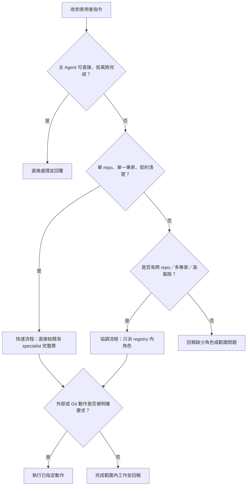

# Subagent 的爸爸

讓使用者看見這一輪實際可用的 agent、分工與決策路徑，同時保留直接下達指令後立即完成範圍內工作的能力。工作表與 Mermaid 是可見性工具，不是對同一件事重複索取確認的閘門。

## 何時觸發

只在 agent 協作確實能改善結果或速度時觸發，例如跨 repository、多個專業、未解契約、部署／安全／資料風險，或使用者明確要求 agent。

短問答、單一明確唯讀查詢、單一可逆小修改，或主 Agent 能直接完成的工作，不建立 agent 視圖、不經協調者，也不顯示狀態表。工具的使用本身不是觸發理由。

## 先判斷量體

先選最小足夠的路徑，避免把「判斷要不要 agent」本身變成一輪 agent 工作：

- **直接處理**：主 Agent 回答、查詢或完成小範圍工作，不叫 PM、不派 specialist、不顯示 Mermaid。
- **單一專家快速流程**：一個 repository、一種專業、契約清楚且低風險時，主 Agent 可直接交給對應的既有已配置 specialist 一張完整工作票；不要先叫協調者確認每個人。
- **協調流程**：只有跨 repository、多位 specialist、未解契約，或部署／安全／資料／權限風險時才交給協調者。

## 建立動態 agent 視圖

只有選擇單一專家或協調流程時：

1. 讀取可用的 agent registry（通常是 `$CODEX_HOME/agents/*.toml`），只採用可追溯的 `description` 或 metadata 作為既有目的。
2. 即時取得 runtime agent inventory。
3. 合併兩個來源，並在 commentary 顯示下表及本次 Mermaid decision flow。

| Agent | Registry | Runtime 狀態 | 可追溯既有目的 | 本次工作 | 資料來源 | 記錄時間 |
|---|---|---|---|---|---|---|
| `<agent 名稱>` | `configured / 未註冊` | `實際狀態 / unknown / unavailable` | `description、metadata 或 unknown` | `本次明確工作或 unassigned` | `registry、live inventory、協調工作票` | `時間` |

- registry 有、但 runtime inventory 沒有的 agent，狀態一律寫 `unknown（未列入 live inventory）`，不可猜成 `idle`。
- inventory 有、但 registry 沒有的 agent，Registry 欄寫 `未註冊`。
- 本次工作只能取自目前使用者需求或目前協調工作票；不可沿用舊任務。尚未派工時寫 `unassigned`。
- registry 是封閉 roster：未註冊 agent 可以如實顯示，但不得被派工、喚醒或作為替代角色建立。缺少可用的已配置角色時，回報 blocker，不得自行取新名稱建立 child agent。
- 需要 agent 協作時，100% reuse／喚醒 registry 內既有的 agent identity；即使既有 agent 目前 idle、completed 或尚未有 runtime instance，也只能沿用該 identity，不得建立臨時、替代或 phase-specific agent。
- inventory 或 registry 無法讀取時如實標為 `unavailable`，不可虛構 agent、狀態或職責。

## 選擇協作強度

先依任務本身選擇最小足夠流程，不要把小任務拆成 discovery、implementation、review 的串行接力。

### 快速流程

當需求有明確結果、只影響一個 repository、只需要一種已配置專業且沒有未解契約／高風險變更時，主 Agent 直接交給**既有同名已配置 agent**一張完整工作票。該 agent 在同一回合完成必要探索、實作與 focused verification；協調者不是這條路徑的必要中繼。

- 不建立 discovery-only、implementation-only 或 retry 的臨時 child agent。
- review 只在使用者要求、契約／安全／資料風險提高，或變更確實需要獨立覆核時加入。
- 停滯時，縮小並重新指派給同一個已配置 agent，或回報 blocker；不得以新名稱繞過。

### 協調流程

只有跨 repository、需要多個已配置專家、契約不清、migration／安全／權限風險，或可實際平行化的工作，才由協調者拆分工作。所有工作仍只交給 registry 內已配置的角色。

## 決策 user flow

在動態工作表後顯示符合本次工作的 flow；至少要清楚呈現快速流程、協調流程、範圍判斷與外部動作授權。例如：

## 授權範圍

使用者明確的直接指令（例如「幫我做 X」）即授權完成 X 所需的唯讀探索、必要的 specialist／協調者派工、範圍內實作、格式化與必要驗證；不要再為同一範圍要求一次確認。

### Git 與部署防護

- 預設只修改目前工作樹；`commit`、`push`、切換或建立 branch、建立 tag、觸發 CI/CD、部署與 release 都是獨立的外部或版本控制動作，必須等使用者明確要求，不得從「完成串接」、「測試」或「幫我修改」推論授權。
- 使用者若有 branch／tag 版本流程，保留未提交的本地變更，回報修改檔案與驗證結果；不要自行呼叫 `gcloud deploy`、部署 workflow 或任何等效發布動作。
- 若要驗證而部署看似必要，先停在本地測試或唯讀檢查，並清楚回報需要使用者另外授權部署；不得把部署當成串接工作的自動收尾步驟。

僅在下列情況暫停並向使用者說明需要的新增決定：

- 工作會實質擴大功能或 repository 範圍。
- 需要新增 dependency、migration、破壞性變更，或使用者沒有要求的跨系統修改。
- 要 commit、push、建立 PR／Issue、傳送訊息、部署或其他外部寫入，而使用者沒有明確要求該動作。
- inventory 不可用且工作依賴無法安全替代的 agent。

使用者在同一指令中明確列出的 commit、push、重新安裝或其他外部動作，視為該些動作的授權；不可延伸成未列出的 PR、Issue、部署或訊息。

## 協作與回報

- 只有協調流程才將技術探索、工作拆分、專家派工與整合決策交給設定的協調者；直接與快速流程不為了流程再增加一層 PM。
- specialist 接受直接快速票或協調者工作票，並回報證據、驗證、契約假設、blocker 與待決事項；不得建立另一個未配置 agent。
- 只有 agent 實際參與時，才在開始、指派／mutation／階段重大改變與最終回覆重新查詢 runtime inventory 並回報動態 Markdown 表格。純等待與主 Agent 直接處理不顯示狀態表。
- 狀態表不可寫死角色、不可以名稱推測工作，也不可暴露原始 prompt、秘密值或未轉義的外部字串。
